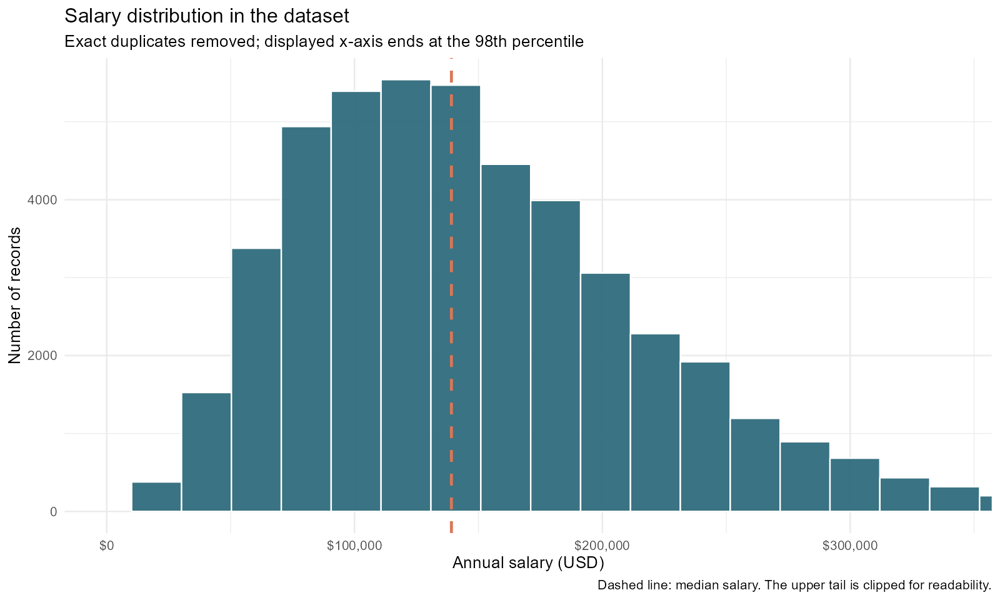
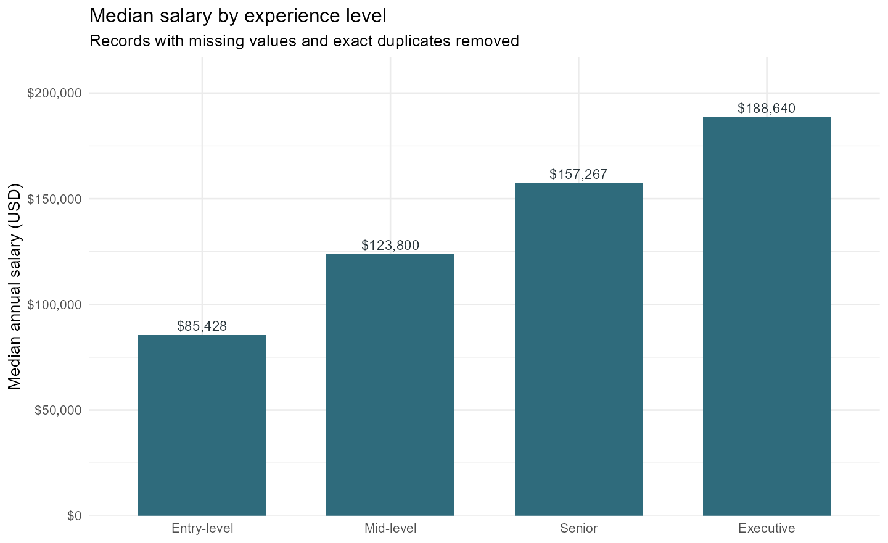
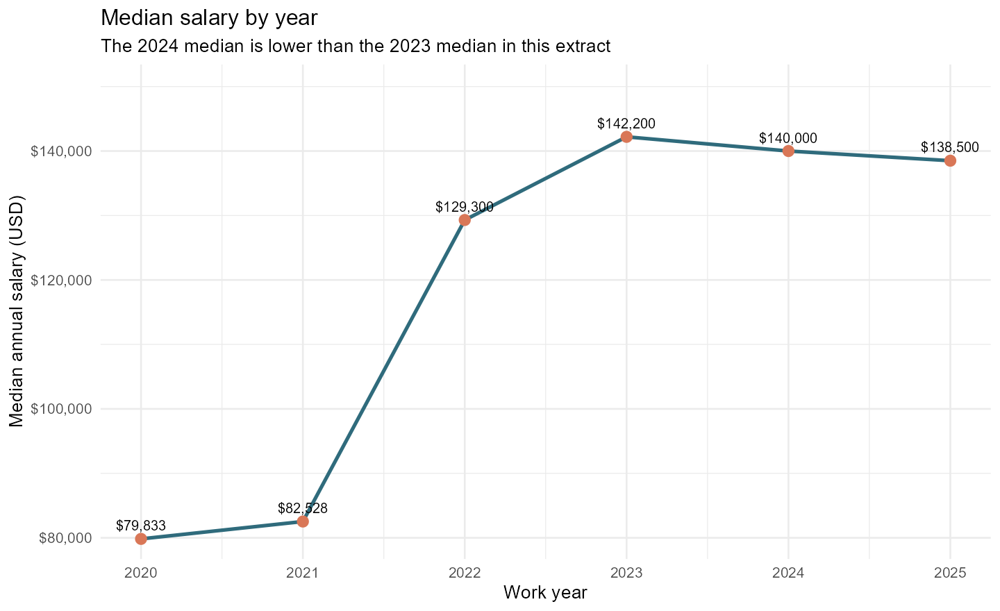
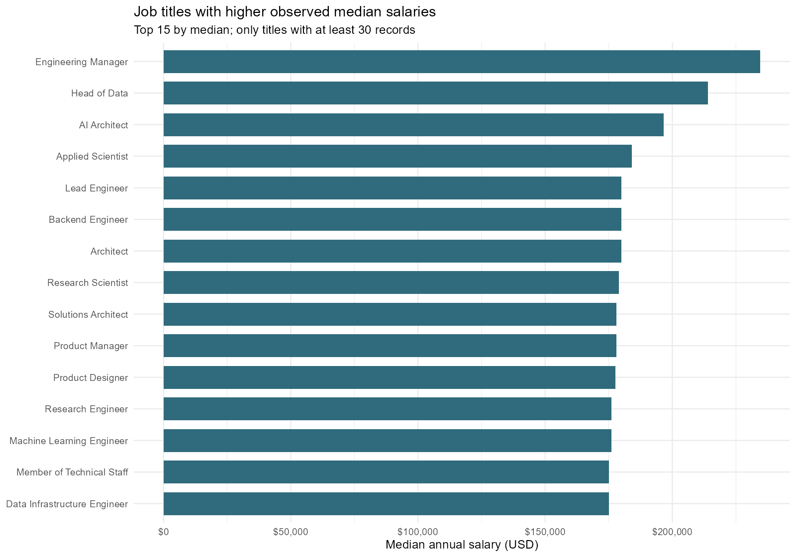

# Data Science Salary Analysis (R)

An end-to-end R data analysis project exploring salary patterns across Data Science, Analytics, and Machine Learning roles. The project follows a practical **CRISP-DM-inspired workflow**: understand the question, inspect the dataset, prepare the data, explore the results, and evaluate a baseline model.

**Question:** What salary patterns appear across role titles, experience levels, and years in the available dataset?

> This is an educational portfolio project, not a salary guarantee or a substitute for current, location-specific salary research.

[Deutsch](README_DE.md) · [Dataset & licensing notes](docs/DATA_AND_LICENSE.md) · [Data dictionary](docs/DATA_DICTIONARY.md) · [GitHub setup](docs/GITHUB_SETUP.md)

## Project snapshot

| Item | Value |
|---|---:|
| Source records | 14,838 |
| Variables | 11 |
| Missing cells in source file | 0 |
| Exact duplicate rows flagged | 5,711 |
| Rows after dropping missing rows and exact duplicates | 9,127 |
| Years covered | 2020–2024 |
| Main tools | R, tidyverse, ggplot2, linear regression |

Exact duplicate records are removed from the main exploratory dataset to avoid counting identical rows repeatedly. Because identical rows can sometimes represent separate records in an upstream dataset, the number removed is recorded and this choice should be revisited before using the results for decisions.

## Preview of the analysis

### Salary distribution



### Median salary by experience level



### Median salary by year



### Higher-median job titles



The job-title chart only includes titles with at least 30 records after cleaning. That minimum-count filter makes the comparison less sensitive to very small groups; it does not remove all sampling or reporting bias.

## Initial findings

- **Experience level is associated with salary differences** in this dataset. The median salary rises from around **$80,000** for entry-level records to around **$154,000** for senior-level records and **$190,250** for executive-level records after exact-duplicate removal.
- **Role titles matter.** Among job titles with at least 30 cleaned records, *Head of Data*, *Director of Data Science*, and *Applied Scientist* are among the titles with the highest medians in this extract. The comparisons are descriptive, not causal, and are affected by geography, industry mix, company, and seniority.
- **The year trend is not a simple straight line.** The median rises from 2020 through 2023, then is lower in 2024 in this cleaned extract. The Pearson correlation between `work_year` and `salary_in_usd` is weak (about **0.114**) after exact-duplicate removal.
- **Data quality needs attention.** The source contains 5,711 exact duplicate rows. The records also heavily represent US-based jobs, so global averages should not be treated as representative of every country.

All figures and summary tables in `outputs/` are committed as a quick preview. Running the R scripts regenerates the outputs from the raw CSV.

## Repository structure

```text
.
├── R/
│   ├── 00_setup.R                  # shared loading, cleaning, and output helpers
│   ├── 01_data_quality.R           # data quality checks and report
│   ├── 02_exploratory_analysis.R   # summary tables and visualizations
│   ├── 03_salary_model.R           # baseline regression and hold-out evaluation
│   └── run_all.R                   # run the complete workflow
├── data/
│   ├── raw/                        # download the CSV here; raw data is not committed
│   └── processed/                  # generated cleaned dataset
├── docs/
│   ├── DATA_AND_LICENSE.md
│   ├── DATA_DICTIONARY.md
│   └── PROJECT_OVERVIEW.md
├── outputs/
│   ├── figures/                    # generated PNG charts
│   └── tables/                     # generated CSV summaries
├── Assignment.Rproj
├── README.md
├── README_DE.md
└── .gitignore
```

## Getting started

### 1. Requirements

- R 4.1 or newer
- RStudio (recommended)
- The `tidyverse` package

Open `Assignment.Rproj` in RStudio, then install the dependency once:

```r
install.packages("tidyverse")
```

### 2. Download the dataset

The CSV is not included in this public-ready repository. Download **Latest Data Science Job Salaries 2020–2024** from [Kaggle](https://www.kaggle.com/datasets/saurabhbadole/latest-data-science-job-salaries-2024) and place the file at:

```text
data/raw/DataScience_salaries_2024.csv
```

See [data and licensing notes](docs/DATA_AND_LICENSE.md) before redistributing the source data.

### 3. Run the complete analysis

From the project root in RStudio:

```r
source("R/run_all.R")
```

Or run each step individually:

```r
source("R/01_data_quality.R")
source("R/02_exploratory_analysis.R")
source("R/03_salary_model.R")
```

The scripts write processed data, tables, and visualizations to `data/processed/` and `outputs/`.

## Methodology

1. **Business understanding:** explore salary patterns that may support career research.
2. **Data understanding:** check dimensions, variable types, missing values, duplicates, and summary statistics.
3. **Data preparation:** drop rows with missing values and remove exact duplicate rows for the primary descriptive analysis.
4. **Exploratory analysis:** compare salary distributions by year, experience level, and job title; calculate the year/salary correlation.
5. **Baseline modeling:** fit a log-linear regression using role, experience, year, employment type, remote-work ratio, and company size; compare it with a median-only baseline on a random 80/20 hold-out split.
6. **Evaluation:** report RMSE, MAE, and R². The model is a baseline, not a deployment-ready salary estimator.

## Limitations

- The dataset is observational and contains no complete information about all factors affecting pay (e.g. industry, benefits, company financials, negotiation, and local cost of living).
- Records are geographically imbalanced, with substantial US representation.
- Exact duplicate removal is a judgment call and may change estimates; the data quality report exposes the number removed.
- The dataset covers 2020–2024 and should not be interpreted as a live salary feed.
- A single random hold-out split is useful for a first baseline but is not sufficient for production-level model validation.
- Correlation does not establish causation. Salary differences between groups should not be read as the causal effect of a single factor.

## Next improvements

- Compare results with and without exact-duplicate removal.
- Add a chronological evaluation split to test generalization to a later year.
- Compare linear regression with a tree-based model and use cross-validation.
- Add confidence intervals and salary distributions by geography.
- Turn the analysis into a small interactive dashboard after validation.

## Source

Badole, S. *Latest Data Science Job Salaries 2020–2024*. Kaggle. [Dataset page](https://www.kaggle.com/datasets/saurabhbadole/latest-data-science-job-salaries-2024).

